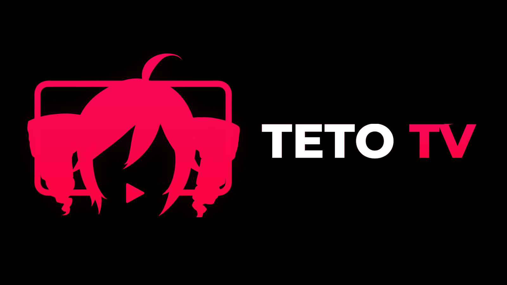
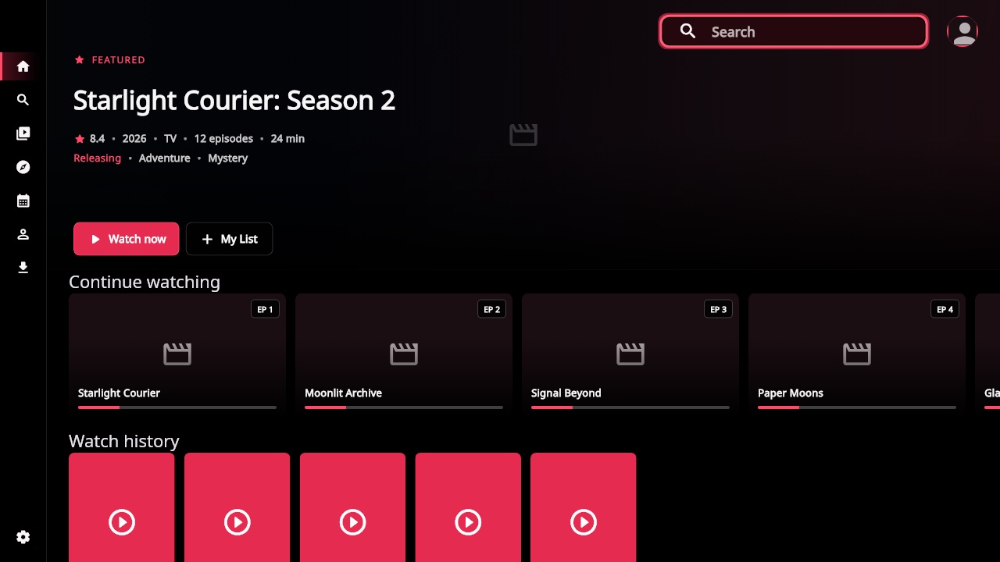
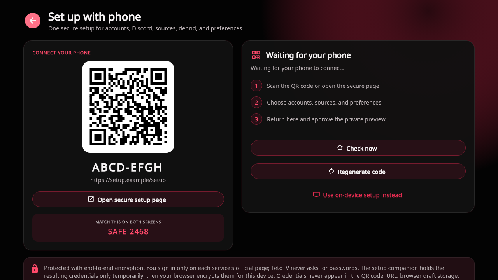
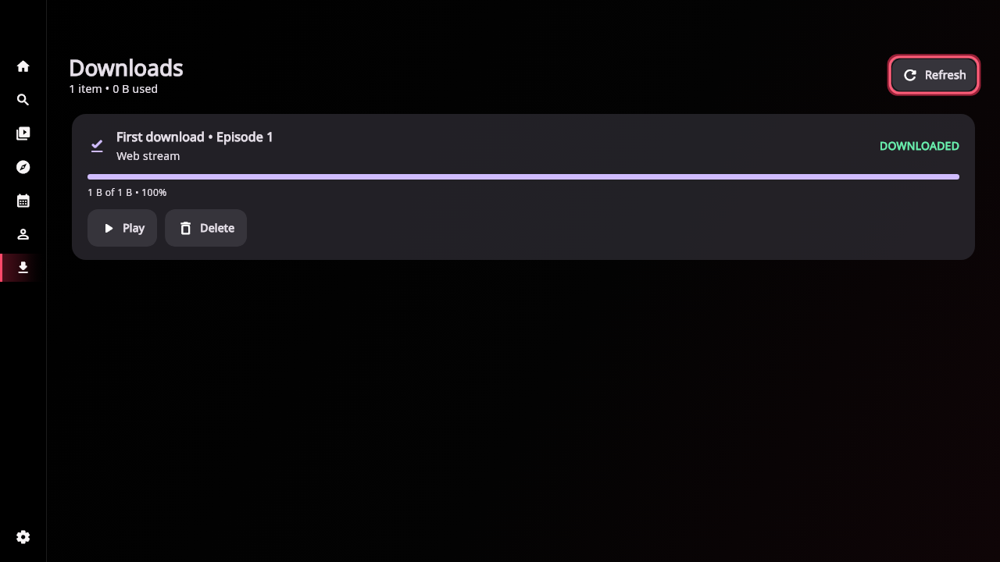
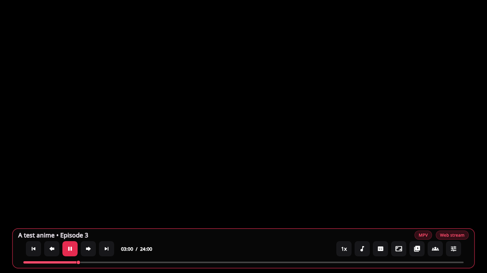
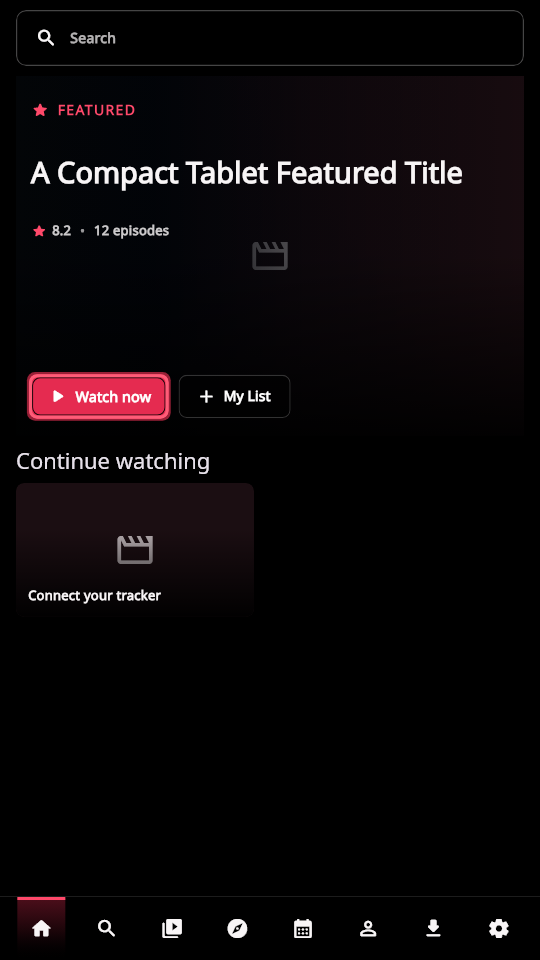

  

<h1 align="center">TetoTV Beta</h1>

  <strong>One media library, playback, and tracking experience for Android TV, Google TV, Fire TV, phones, tablets, and Windows.</strong>

  
  
  
  

  <a href="https://github.com/LindersOSX/TetoTV-Beta/releases/download/v1.0.84/TetoTV-v1.0.84-universal.apk"><strong>Download Android</strong></a>
  · <a href="https://github.com/LindersOSX/TetoTV-Beta/releases/download/v1.0.84/TetoTV-v1.0.84-build410084-windows-x64-release-setup.exe"><strong>Download Windows</strong></a>
  · <a href="https://github.com/LindersOSX/TetoTV-Beta/releases/tag/v1.0.84">Release notes</a>
  · <a href="https://discord.gg/juC6k7d4WY">Discord</a>
  · <a href="https://www.youtube.com/@TetoTVApp">YouTube</a>

> [!IMPORTANT]
> TetoTV is a user-configured media client. It does not host or supply media, third-party source catalogs, provider extensions, or credentials. No third-party media provider or repository is bundled or preconfigured. Technical compatibility is not an endorsement of a provider. Only connect, play, and download media you are authorized to access.

TetoTV runs directly on your device. Normal browsing and playback do not require a companion server. Android and Windows share the same app design and portable settings format, with platform-specific playback and system integrations.

> [!NOTE]
> **AI-assisted development:** AI tools assist with code, design iteration, documentation, tests, and review. The maintainer directs project decisions and remains responsible for validating changes and approving releases. AI assistance is not an independent legal or security certification.

## Download TetoTV 1.0.84

Current Android and Windows release: **1.0.84 · build 410084**.

| Device | Download | Requirements |
| --- | --- | --- |
| Android TV, Google TV, Fire TV, phones, and tablets | [Universal Android APK](https://github.com/LindersOSX/TetoTV-Beta/releases/download/v1.0.84/TetoTV-v1.0.84-universal.apk) | Android 7.0 / API 24 or newer; ARM32 or ARM64. Fire OS 6 or newer. |
| Windows PC — recommended installation | [Windows x64 installer](https://github.com/LindersOSX/TetoTV-Beta/releases/download/v1.0.84/TetoTV-v1.0.84-build410084-windows-x64-release-setup.exe) | Windows 10 or 11 x64. Setup offers a desktop shortcut, selected by default. |
| Windows PC — no installer | [Windows x64 portable ZIP](https://github.com/LindersOSX/TetoTV-Beta/releases/download/v1.0.84/TetoTV-v1.0.84-build410084-windows-x64-release.zip) | Extract the entire ZIP, then run `TetoTV.exe`. Keep its folders and DLLs together. Settings are still stored in your Windows user profile. |

Windows builds are currently **unsigned Beta builds**, not Microsoft Store-certified. Download only from the official release and review any Windows security warning. Windows on ARM is not a separately supported build. Fire OS 5 is below the Android minimum.

**macOS, Linux, and iOS builds are not currently available.**

[All release files and checksums](https://github.com/LindersOSX/TetoTV-Beta/releases/tag/v1.0.84) · [Shared Android/Windows application source](https://github.com/LindersOSX/TetoTV-Beta/releases/download/v1.0.84/TetoTV-v1.0.84-source.zip) · [Android native playback source bundle](https://github.com/LindersOSX/TetoTV-Beta/releases/download/v1.0.84/TetoTV-v1.0.84-native-playback-sources.zip)

> [!NOTE]
> **Upgrading from the older 2.0.x Beta:** GitHub's “Latest” label may still point to the temporary **2.0.80 migration bridge**. Use the **1.0.84 links above for a new installation**. Older Android installations may first be offered the bridge, then the current release after reopening the app. The displayed version changed to 1.x; Android upgrade order follows the increasing build code, not the displayed version alone. Do not uninstall just to update, as uninstalling can remove local app data.

## What's new in 1.0.84

- **Windows desktop support:** the familiar TetoTV interface with MPV playback, keyboard and controller navigation, desktop Discord Rich Presence, and a selectable download folder.
- **Easier device transfers:** send settings and supported account data between Android and Windows over the same Wi-Fi or wired LAN using a six-digit code. No camera is required.
- **Downloader-code config import:** enter a code or supported download link, review the configuration and repository links, then apply it.
- **Fresher airing information:** release metadata refreshes during an active session, at known airtimes, and after returning to the app. Periodic checks run about every five minutes while active; a restart is no longer required.
- **Extended Aniyomi compatibility:** improved imported APK source discovery on Windows, including multilingual extensions. Compatibility is still extension-dependent.
- **Playback and interface refinements:** improved automatic stream selection, focus handling, navigation, captions, and visual consistency.

An airing update refreshes catalog information; it does not guarantee that a provider has uploaded or indexed a playable stream within five minutes.

## See TetoTV in action

  

<table>
  <tr>
    <td width="50%"></td>
    <td width="50%"></td>
  </tr>
</table>

  

  

  

<a href="https://www.youtube.com/watch?v=RUNRto8dQEk"><strong>Watch the TetoTV setup walkthrough</strong></a>

<em>These captures use synthetic demo titles and local fixtures. The displayed QR points to a reserved <code>.example</code> domain and is not a live pairing session. Screenshots illustrate the interface and may differ from the current build.</em>

## Built for the couch, phone, and desktop

| Experience | What to expect |
| --- | --- |
| TV and remote | Visible focus, predictable D-pad navigation, readable spacing, and a consistent route back to navigation. |
| Phones and tablets | Touch-friendly controls, compact layouts, bottom navigation in portrait, and a sidebar on wider layouts. |
| Windows desktop | The same shelves, themes, accounts, and settings, with mouse, keyboard, controller, and native desktop integrations. |
| Local profiles | Use TetoTV without a tracker account, or connect supported services when you want syncing. |

### Playback and Caption Studio

- Android offers **Media3 (Built in)** and **MPV**. Windows uses **MPV**; importing an Android player preference does not try to run Media3 on Windows.
- Shared TetoTV controls cover playback, seeking, speed, audio/subtitle selection, resume progress, and recovery actions when a stream fails.
- **Caption Studio** brings caption defaults, language, numeric text sizes down to 12, text color, background, outline color/thickness, and placement into one preview-based screen.
- Caption customization depends on the subtitle format. Image-based and burned-in subtitles cannot be restyled like ordinary text subtitles.
- Automatic stream selection considers preferences and compatibility. Resolution, codec, HDR, network speed, and the selected source still affect playback; 4K/HDR support is not a guarantee for every device or file.
- Windows can hand supported playback to an installed external player. Trailers open in the browser on Windows.

### Windows keyboard and controller controls

| Input | Action |
| --- | --- |
| Space | Pause or resume the current video. |
| Escape / Backspace | Dismiss the current panel or go back; player exit confirmation is respected. Backspace still edits a focused text field. |
| F11 | Toggle fullscreen. |
| Controller D-pad / left stick | Move focus. |
| Xbox A / PlayStation Cross / Switch A | Select. |
| Xbox B / PlayStation Circle / Switch B | Go back. |
| Menu / Options / + | Open options. |
| LB/RB · L1/R1 · L/R | Previous/next Settings page; seek backward/forward while watching. |
| Right-stick click | Pause or resume playback. |

Xbox, PlayStation, and Nintendo Switch controller families are supported through the Windows controller layer. Pair USB/Bluetooth controllers in Windows first. Individual models, drivers, and connection modes can differ; this is not a certification of every controller.

### Accounts, tracking, and Discord

- Optional **AniList**, **MyAnimeList**, and **SIMKL** integrations provide supported lists, status, and episode-progress syncing. SIMKL availability depends on the configured service deployment.
- Account linking uses the appropriate approval flow for the device. Windows opens approval pages in your PC browser; no phone camera is required for normal PC linking.
- Optional **Discord Rich Presence** can share the current show or manga and its public artwork, subject to privacy settings and Discord's display rules.
- On **Windows**, Rich Presence connects to the running Discord desktop app. It does not require linking the Android Discord account flow. Enable activity sharing in Discord and opt in inside TetoTV.
- Optional **Plex** and **Jellyfin** connections use your own configured media server. Supported Debrid connections include **Real-Debrid**, **Premiumize**, **TorBox**, and **AllDebrid**.

TetoTV does not provide accounts, subscriptions, credentials, or access to third-party services.

### Backup, transfer, and config presets

Open **Settings → System → Storage & reset → Backup & transfer**. An **Import settings** shortcut is also available on the first-run language screen.

**Transfer over the same network**

1. Connect both devices to the same private Wi-Fi or wired LAN and open **Transfer over Wi-Fi**.
2. On the receiving device, choose **Receive** to display a six-digit code.
3. On the sending device, choose **Send**, select the discovered device, and enter that code.
4. Review the import on the receiving device, confirm, then close and reopen TetoTV when prompted.

Nearby transfer uses an authenticated, encrypted local connection. No camera, QR scanner, copied web address, or cloud relay is needed. Windows may ask for private-network access; guest-network isolation or firewall rules can prevent discovery.

**Local files and Downloader codes**

- Export a local settings file and move it yourself, or import a trusted config through its supported HTTPS link or numeric Downloader code.
- Review the download location, repositories, included settings, and any account or executable-extension content before applying anything. Some hosting pages or providers may not be supported.
- Shared presets **without logins** keep existing linked accounts. Preset preferences are applied while existing sources are retained and merged rather than removed.
- During first-time setup, an imported preset fills the setup choices; the normal account-linking flow remains available. The app confirms when the configuration has been applied after reopening.
- New backups can include installed scripts and approved extension APKs. Import requires explicit code approval and rechecks their identities; it does not make an incompatible extension work on another platform. Older backups may only contain reinstall hints.
- Downloaded media, watch/read history, operating-system permissions, and device-local folder access are not part of a settings transfer. Some accounts or sources may require fresh authorization. Manga-library backup is a separate feature.

> [!WARNING]
> **Settings files can contain login tokens.** Password protection is optional for file exports. An unprotected export is readable and must be treated like a password: do not upload a personal backup to GitHub, chat, or a public file host. Only share presets you have checked contain no credentials or other private data. Existing encrypted backups still need their original password.

### User-supplied sources and extensions

TetoTV starts without a preconfigured media provider or repository. Add only sources you trust and are authorized to use through **Manage sources**.

| Extension type | Android | Windows |
| --- | --- | --- |
| Compatible Seanime-format anime/manga scripts | Supported through the bounded script runtime. | Supported through the desktop script runtime. |
| Compatible Aniyomi/Tachiyomi-family anime or manga APK extensions | Experimental; requires the appropriate feature and trust approval. | Experimental HTTP-source compatibility through an isolated APK runtime. |

**Listing or installing an extension does not prove every source operation works.** Provider changes, access blocks, language availability, unsupported APIs, or expired authorization can affect searching, chapters, images, and playback.

Windows APK support is **not a full Android emulator**. Extensions requiring Android WebView, provider-native libraries, or extension-local socket/HLS servers are not currently supported there. Imported extensions retain the same compatibility limits. TetoTV does not promise that every Aniyomi, Mihon, or third-party repository extension will work.

Extensions are untrusted third-party code. Their providers can observe the searches and media requests needed to serve content, together with ordinary connection information such as your public IP address. Compatibility does not establish safety, legality, availability, or endorsement.

### Optional experimental Manga reader

Enable **Experimental options** in **Settings → System**, and keep **Manga reader** enabled under **Services**, to show the Manga area. Both are required in the current build. Disabling Manga hides it without deleting the saved library and downloads.

- A Home-style Manga hub with portrait covers, **Continue reading**, library shelves, and source browsing.
- Search matching the app's selected language, with matching titles grouped across sources while different editions and translations stay separate. Choose the source inside a grouped result.
- Manga descriptions, chapter lists, reading status, categories, unread filters, and chapter bookmarks.
- Paged, vertical, and webtoon reading; left-to-right/right-to-left navigation; single/double-page layouts; zoom and fit controls.
- In-reader chapter selection, a page-thumbnail strip, and exact **page bookmarks**.
- Page retry and supported source-access recovery without leaving the chapter, preserving reading position where possible.
- Optional border trimming and a phone rotation choice of automatic, portrait, or landscape.
- Chapter downloads, offline indicators, storage information, and queues for the next 5 or 10 unread chapters.
- Cover recovery and a manual cover-selection option when an automatic match is unreliable.
- Optional AniList/MyAnimeList Reading shelves and explicitly matched chapter-progress syncing. SIMKL is not a manga tracker.

Manga availability, language coverage, and chapter/page loading depend on the installed source. No Manga catalog or provider is bundled. The separate Manga-library backup covers supported library/history data, not downloaded page files or account credentials.

### Downloads and local media

Download supported, authorized episodes individually or as a season queue. The Download Manager shows progress, speed, storage use, queue state, and pause/resume/retry controls. Completed files can be selected through the usual offline playback flow.

On Windows, use **Downloads → Folder** to choose the location for **new episode downloads**. Existing jobs keep their original location; changing the folder does not move old files. A disconnected external drive is shown as unavailable rather than silently deleting its download records.

Android background downloads are best-effort and can be interrupted by force-stop, process termination, or system restrictions. Windows work can also be interrupted by closing the app or suspending the PC. Recovery depends on the job and source; paused jobs may need an explicit resume, and expired source access may require reselection. Do not treat either platform as an always-running download server.

### Watch Party

Create or join a room with a code and follow the host's playback. The lobby can show what the host is browsing, and the in-player room panel keeps room information focused on the code and participants.

Everyone plays through their own authorized source or local file. TetoTV synchronizes room state, public show identity, and playback timing through its hosted coordination service; it does not relay the group's media stream or share source credentials. Connection quality and each participant's source still affect synchronization.

### Optional direct torrents

Direct peer-to-peer playback and downloads are optional Beta features, off by default, with an explicit privacy warning. Native integration is available on Android and Windows, subject to platform and source compatibility.

Peers and trackers can see your public IP address, and the device may upload pieces. Only enable this for material you are authorized to access and share. TetoTV does not bundle a torrent index or media catalog.

## Updates

- **Android** downloads Android APK updates and validates package/version/signing information before handing installation to Android. The operating system still requires its normal permissions and approval; TetoTV cannot silently bypass them.
- **Windows** selects compatible Windows update metadata from GitHub releases instead of assuming GitHub's “Latest” release is a Windows build. It verifies the installer download against the matching metadata before explicit installation.
- Android and Windows share the **1.0.84** release number but use different packages. A Windows device must not download an APK as its update.
- Older **2.0.x** releases remain part of the migration history, not a separate Windows download line. Build numbers must keep increasing even when the displayed version changes.

For maintainers: publish the generated **Windows update JSON unchanged alongside its matching installer** for each Windows release, and increment the build number for a new update. The JSON is updater metadata, not something users need to install. Changing README download links alone does not configure the updater.

## Diagnostics and privacy

Crash-report preferences are disclosed during setup and can be changed in Settings. Existing installations retain their stored reporting choice. Manual diagnostics require choosing to share a report.

Current reports identify the operating system, OS version/build, device class, and TetoTV version/build so Android and Windows problems can be distinguished. Reports are bounded and redact credentials and private playback/source details. Review reports before sharing, especially advanced troubleshooting reports; never attach a personal settings backup as a diagnostic.

Optional tracking, Discord activity, Watch Party, and other network features have their own privacy controls. Read the [privacy documentation](docs/PRIVACY.md) for data handling, reporting, optional aggregate Beta presence, and network behavior.

## Source code and licenses

TetoTV-authored source is available under the [MIT License](LICENSE). Bundled third-party components retain their own licenses and terms; MIT does not relicense the native playback engines or other dependencies.

For **1.0.84**, use the [matching shared application source ZIP](https://github.com/LindersOSX/TetoTV-Beta/releases/download/v1.0.84/TetoTV-v1.0.84-source.zip) and [Android native playback source bundle](https://github.com/LindersOSX/TetoTV-Beta/releases/download/v1.0.84/TetoTV-v1.0.84-native-playback-sources.zip) attached to the release. The application ZIP includes the Android and Windows app code, tests, documentation, and build/release tooling. GitHub's automatic source archives reflect the tagged commit and are not a substitute for those separately published release files. Private signing keys, account configuration, and proprietary SDK archives are not included.

The matching source ZIP also contains the desktop build and compatibility guides: `docs/BUILD_WINDOWS_DESKTOP.md`, `docs/WINDOWS_ANIYOMI_RUNTIME.md`, and `docs/LOCAL_SETTINGS_BACKUP.md`. Android Discord support requires obtaining its proprietary SDK separately under its terms.

> [!WARNING]
> Beta availability and checksum verification are not independent native-license or corresponding-source review. Windows native redistribution and exact corresponding-source review remain outstanding; no source-offer completeness, independent clearance, or reproducible native rebuild is claimed. See the [native release review requirements](docs/NATIVE_LICENSE_RELEASE_REVIEW.md) and [third-party notices](docs/THIRD_PARTY_NOTICES.md).

TetoTV is not affiliated with, sponsored by, or endorsed by AniList, MyAnimeList, SIMKL, Discord, Amazon, Google, Microsoft, Plex, Jellyfin, or any streaming, extension, or Debrid provider. See the [content and source policy](CONTENT_POLICY.md) for repository boundaries and rights reports.

## Project documentation

Some repository documents describe older builds. For current platform-specific behavior, use the documentation included in the matching **1.0.84 source ZIP**.

| Document | Covers |
| --- | --- |
| [1.0.84 release](https://github.com/LindersOSX/TetoTV-Beta/releases/tag/v1.0.84) | Current Android/Windows downloads, release notes, source bundles, and checksums. |
| [Content and source policy](CONTENT_POLICY.md) | Repository boundaries, prohibited source material, and rights reports. |
| [Privacy documentation](docs/PRIVACY.md) | Optional integrations, diagnostics, data handling, and network behavior. |
| [Security policy](SECURITY.md) | Private vulnerability reporting. |
| [Architecture](docs/ARCHITECTURE.md) | Application layers, storage, playback, and hosted coordination. |
| [Manga library and reader](docs/MANGA_READER.md) | Source-based reading, library data, downloads, and recovery. |
| [Media3 playback](docs/MEDIA3_PLAYBACK.md) | Android's built-in player and its differences from MPV. |
| [Third-party notices](docs/THIRD_PARTY_NOTICES.md) | Component licenses, service terms, and attribution. |

## Help and feedback

[Open a GitHub issue](https://github.com/LindersOSX/TetoTV-Beta/issues/new) for bugs and feature requests, or [join the Discord](https://discord.gg/juC6k7d4WY) for announcements and community support.

Include the **TetoTV version and build**, **OS name and version/build**, **device model**, and reproduction steps. For playback issues, add the player engine, resolution/codec if known, and GPU on Windows. A diagnostic report can help, but never post account tokens, private media links, or personal config exports.

Report security vulnerabilities privately through [SECURITY.md](SECURITY.md), not a public issue.
